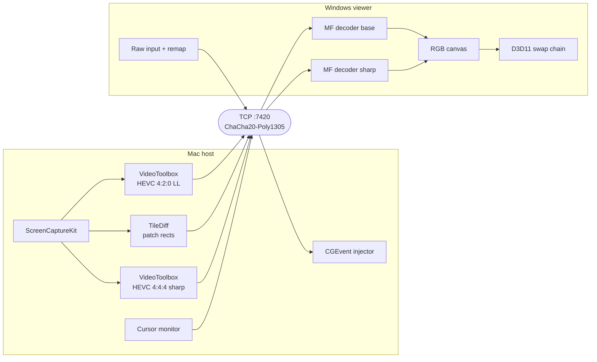

# Glide

[](https://github.com/sudoBrandino/glide/actions/workflows/ci.yml)

[](LICENSE)

Glide is a remote desktop for controlling a Mac from a Windows PC, written from scratch. Both ends
are native:

- **Host (`mac/`, Swift):** ScreenCaptureKit capture, VideoToolbox hardware HEVC, and a
  ChaCha20-Poly1305 record layer over TCP. Input is injected with CGEvent, and cursor shapes are
  sent to the viewer.
- **Viewer (`windows/`, Rust):** Media Foundation hardware decode through D3D11, a flip-model
  swap chain, raw keyboard and mouse capture, and the host cursor shown as the native Windows
  cursor.

## Why

General-purpose remote desktops trade text sharpness for motion, or the other way round. Glide
aims for the sharpness and responsiveness of the best commercial tools on a LAN, for one specific
pairing: a Mac you work on, viewed from a Windows PC.

Its main difference is **hybrid mode**. While the screen changes, Glide streams low-latency HEVC
4:2:0. Once the screen settles, it sends a 4:4:4 "sharp" refinement layer, so text is pixel-exact
at rest and motion stays fast.

## Features

- Hardware HEVC both ways: VideoToolbox encode on the Mac, Media Foundation / D3D11 decode on the PC.
- Hybrid 4:2:0 + 4:4:4 mode, plus `fast` (4:2:0 only), `sharp` (4:4:4 every frame) and an H.264
  fallback.
- The host re-captures at the viewer monitor's size, so video is drawn 1:1 and never upscaled.
- Keyboard (USB HID usages, Ctrl→Cmd remap), mouse, wheel, and the Mac cursor shown as the native
  Windows cursor.
- Clipboard sync (text and images), Mac system audio to the PC, and file transfer in both
  directions.
- End-to-end encrypted with a Noise XX handshake and pinned keys. There are no passwords and no
  accounts; a viewer is paired once with a code confirmed on both screens.
- Either side can open the connection, which helps with one-way firewalls.
- A menu-bar host app with a LaunchAgent, and a viewer with a tray icon, HUD and hotkeys.
- Per-stage latency instrumentation and a glass-to-glass latency test.

## Project status

Glide is a young project that its author uses daily on one hardware pair (Apple silicon Mac,
NVIDIA-GPU Windows PC). It works well there and has had little testing elsewhere.

- **Supported:** macOS 14+ on Apple silicon as the host, Windows 10/11 x64 as the viewer.
- **Not supported:** any other host or viewer platform, and more than one viewer at a time.
- **LAN only.** There is no relay or NAT traversal, and the transport is TCP.
- The wire protocol is at version 2 and may still change in incompatible ways. Both sides detect a
  version mismatch and say so.
- Releases are on the [Releases page](https://github.com/sudoBrandino/glide/releases): a Mac app
  signed ad hoc (not notarized) and an unsigned viewer exe. See [`docs/INSTALL.md`](docs/INSTALL.md)
  to install them, or build both yourself as described below.

See the feature table below and [`docs/ROADMAP.md`](docs/ROADMAP.md) for what is planned.

## Documentation

| | |
|---|---|
| [`docs/INSTALL.md`](docs/INSTALL.md) | Installing a release: Gatekeeper, permissions, firewall, pairing, troubleshooting |
| [`CHANGELOG.md`](CHANGELOG.md) | What changed in each release |
| [`docs/PROTOCOL.md`](docs/PROTOCOL.md) | Wire protocol (normative) |
| [`docs/ARCHITECTURE.md`](docs/ARCHITECTURE.md) | Pipelines, hybrid/canvas model, threading |
| [`docs/ROADMAP.md`](docs/ROADMAP.md) | What's done and what's next |
| [`docs/LATENCY.md`](docs/LATENCY.md) | Latency breakdown, glass-to-glass test, tuning results |
| [`windows/README.md`](windows/README.md) | Viewer reference: all flags, env vars, headless modes |
| [`CONTRIBUTING.md`](CONTRIBUTING.md) | How to build, test and send changes |
| [`SECURITY.md`](SECURITY.md) | How to report a vulnerability |

## Architecture

```
 Mac host (glide-host, Swift)                                Windows viewer (glide-client.exe, Rust)
 ───────────────────────────────                              ──────────────────────────────────────
 ScreenCaptureKit ─┬─ 420v stream ─► TileDiff ─► VT HEVC 4:2:0 ─┐      ┌─► MF decoder #1 (base) ──┐
   (display)       │   (pixel diff → dirty rects, 16-px aligned)│      │                           ▼
                   └─ BGRA stream ─────────────► VT HEVC 4:4:4 ─┤      │                    RGB10A2 canvas ─► D3D11
                       (hybrid "sharp" layer, at rest)          │      │                    (scissored rect ▲  flip-model
 CursorMonitor ─► cursor shape / position ──────────────────────┤      ├─► MF decoder #2 (sharp)─┘   swap chain
                                                                ▼      │
                                          ChaCha20-Poly1305 records over TCP :7420
                                          (Noise XX handshake, pinned keys)
                                                                ▲      │
 CGEvent injector ◄── keys (USB HID) / mouse / wheel ───────────┘      └── raw input, Ctrl→Cmd remap, ViewSize
```



See [`docs/ARCHITECTURE.md`](docs/ARCHITECTURE.md) for the details.

## Feature status

| Feature | Status |
|---|---|
| Protocol + reference crypto vectors (Python, Swift, Rust all agree) | done |
| HEVC 4:2:0 low-latency / 4:4:4 "sharp" / H.264 fallback | done |
| **Hybrid mode**: 4:2:0 while moving, 4:4:4 at rest, pixel-diff patch rects, color-matched layers | done |
| Latest-frame-wins scheduling, network backpressure, idle quality refresh | done |
| Keyboard (USB HID usages, Ctrl→Cmd remap, Win/Alt-Tab capture), mouse, wheel, cursor shapes | done |
| Viewer: borderless fullscreen, auto-reconnect, status overlay, dims last frame on disconnect | done |
| `ViewSize`: host re-captures to match the viewer's monitor (no resampling at 1:1) | done |
| Dial-out (host → viewer `--listen`) for one-way firewalls, auto-redial | done |
| Signed `Glide Host.app` + LaunchAgent (stable TCC grants), `host.json` config | done |
| Power management: no idle sleep while hosting, display kept awake during a session | done |
| CI: Swift build + selftest, Rust tests, Windows cross-build artifact, vector check | done |
| Clipboard sync (text + images, both directions) | done |
| Audio (SCK system audio → PCM → WASAPI, jitter buffer) | done (§3.2) |
| File transfer, both directions (drag & drop, Finder copy + Ctrl+Alt+Shift+V, menu) | done (§6) |
| Multiple Mac displays: display picker (viewer menu, Ctrl+Alt+Shift+←/→, Mac menu bar), hot-plug fallback, remembered choice | done (§3.5) |
| Viewer UX | in progress |
| Host UX: menu-bar item, automatic display mode, auth-gated session replacement | done |
| Security v2: Noise XX, key pinning, pairing with a code confirmed on both screens | done (PROTOCOL.md §1–2) |
| Virtual display, UDP transport, multi-monitor, relay for WAN | planned |

## Performance

Measured on an M3 Pro host with an RTX 5070 Ti viewer.

**Encode time on the host:** base layer, HEVC 4:2:0, **normal rate control (the default)**.
Low-latency rate control is opt-in with `GLIDE_LL=1`. Offline at 2560×1440 it was about 3.5 ms
slower and produced a softer picture (`glide-host --encode-bench`, [`docs/LATENCY.md`](docs/LATENCY.md)).

| Output | Continuous motion (≥ 20 fps) | Isolated frame after idle (≤ 5 fps), e.g. one keystroke |
|---|---|---|
| 2560×1440 | ~10.5 ms | ~11 ms with frame-counter PTS (default); ~20 ms with the old wall-clock PTS |
| 3840×2160 | ~18 ms | not measured |

The encoder PTS is now a frame counter at the nominal rate. With wall-clock timestamps,
VideoToolbox's real-time mode paced itself by the gap since the previous frame, so the first
frame after an idle period took about 9 ms longer at the same size. `GLIDE_PTS=wallclock`
restores the old behavior for A/B tests. The 2560×1440 figures were measured offline with
synthetic text; the live LAN run is still pending.

The 4:4:4 sharp IDR costs about 25–40 ms of encoder time at 4K. It is only sent once the screen
settles, and at most once per interval while small areas such as a clock or spinner keep changing.
The pixel diff runs in parallel with the hardware encode.

**Capture → decoded, same-Mac loopback (`glide-probe`), 2560×1440 @ 60 Hz** (earlier
measurements, before the PTS change):

| Config | p50 / p95 |
|---|---|
| HEVC 4:2:0, normal RC, 1 frame in flight (default) | 12.4 / 37.5 ms |
| HEVC 4:2:0, low-latency RC (`GLIDE_LL=1`) | 14.8 / 21.9 ms |
| H.264 low-latency | 14.5 / 22.0 ms |
| HEVC 4:4:4 every frame ("sharp" mode) | 27.7 / 42.5 ms |
| any config, 2 frames in flight | +10–20 ms (queueing) |

**Latency breakdown.** Every frame carries a per-stage breakdown. It shows up in:

- the viewer HUD
- the host log and menu bar
- `--bench`

A block-code test pattern measures true glass-to-glass latency. See
[`docs/LATENCY.md`](docs/LATENCY.md); the live LAN glass-to-glass run is still pending.

## Install and run

To install a prebuilt release instead of building from source, follow
[`docs/INSTALL.md`](docs/INSTALL.md).

### Requirements

- **Host:** macOS 14 or later on Apple silicon, which has hardware HEVC 4:4:4 encode. Building
  needs Swift 6, either from Xcode or the Command Line Tools.
- **Viewer:** Windows 10/11 with a GPU that hardware-decodes HEVC. The HEVC 4:4:4 decode needed
  for hybrid and sharp mode requires a recent NVIDIA or Intel GPU. HEVC decode on Windows also
  needs the "HEVC Video Extensions" from the Microsoft Store.
- **Building the viewer:** Rust stable. To cross-compile from the Mac, you also need MinGW-w64
  (`brew install mingw-w64`).

### Host (Mac)

```sh
# Build, sign and install "Glide Host.app" + a per-user LaunchAgent (starts at login, restarts on exit)
tools/make-host-app.sh && tools/install-host.sh
```

- `make-host-app.sh` signs the app ad hoc by default. With an ad-hoc signature, macOS privacy
  grants may need to be renewed after each rebuild. To keep them, sign with a stable identity:
  set `GLIDE_SIGN_ID="<identity>"` (list yours with `security find-identity -v -p codesigning`).
- `GLIDE_BUNDLE_ID` sets the app's bundle identifier, which is also the LaunchAgent label
  (default `io.github.sudobrandino.glide.host`). Put your values in `.dev/build.env`, which is
  gitignored; see [`tools/build-env.sh`](tools/build-env.sh).
- `install-host.sh --no-start` installs without starting the app. `install-host.sh --uninstall`
  removes the app and the agent, but keeps the config.
- The log is written to `~/Library/Logs/glide-host.log`.

**Permissions.** The host needs **Screen Recording** to capture and **Accessibility** to inject
input. Grant both to *Glide Host*, not to Terminal:

```sh
~/Applications/Glide\ Host.app/Contents/MacOS/glide-host --request-permissions
```

This prompts for both permissions and waits until they are granted. A new Screen Recording grant
only takes effect after the host restarts. The LaunchAgent restarts it on its own, or you can run
`launchctl kickstart -k gui/$(id -u)/<bundle id>`.

**Configuration** is stored in `~/Library/Application Support/Glide/host.json` (mode 0600):

| key | meaning |
|---|---|
| `pairedViewers` | Viewers allowed to connect: `name`, public `key`, `paired` date (see Pairing below) |
| `salt`, `password` | v1 leftovers: no longer used (kept so a rollback to v1 still works) |
| `connect` | Default dial-out target (`HOST[:PORT]`). If it is set, the host dials the viewer instead of listening |
| `clipboard` | `{"syncConcealed": false}`. `true` also syncs password-manager (concealed) pasteboard items to the viewer |

```sh
H=~/Applications/Glide\ Host.app/Contents/MacOS/glide-host
"$H" --set-connect 192.168.1.60:7420         # make the host dial this viewer by default
"$H" --pair                                  # open the 2-minute pairing window (see Pairing)
"$H" --paired                                # list paired viewers;  --unpair NAME|KEY removes one
"$H" --identity                              # this Mac's key fingerprint
```

The host's key is `host-key` in the same folder (0600; created on first start). Other flags:

- `--port N` (default 7420)
- `--connect HOST[:PORT]`
- `--fps N` (default 60)
- `--bitrate-kbps N` (0 means automatic)
- `--max-width PX` (default 3840)
- `--display ID`: the default display to stream (a `CGDirectDisplayID`; the host logs the list at
  startup). Without it the host streams the current main display. A viewer can pick another
  display for its session (Glide menu → Show Mac display, Ctrl+Alt+Shift+←/→), and so can the Mac's
  menu bar (Streamed Display); see PROTOCOL.md §3.5.

**For development**, without the app bundle:

```sh
cd mac && swift build -c release --build-system native   # native backend: needed with CLT-only setups
.build/release/glide-selftest ../docs/test-vectors.json  # protocol self-test
.build/release/glide-host                              # listen
.build/release/glide-host --connect 192.168.1.60       # dial out
# Local end-to-end check on the same Mac (exact latency); opens a small test window.
# The probe pairs on first use (glide-host --pair, then confirm the printed code).
.build/release/glide-probe 127.0.0.1 --seconds 8 --animate --png /tmp/frame.png
# Protocol-only test instance (no capture/display changes/UI): GLIDE_HOST_TEST_MODE=1
# GLIDE_HOST_CONFIG_DIR=/tmp/x GLIDE_HOST_CONTROL_SOCKET=/tmp/x.sock glide-host --port 7522
```

Stop the LaunchAgent before you run a host from the shell (see Troubleshooting).

### Viewer (Windows)

To get the exe, either:

- download it from the `glide-client-windows-x64` artifact of a green
  [CI run](https://github.com/sudoBrandino/glide/actions/workflows/ci.yml), or
- cross-build it on the Mac:

```sh
cd windows
cargo test                                                 # platform-independent tests incl. vectors
cargo build --release --target x86_64-pc-windows-gnu       # → target/x86_64-pc-windows-gnu/release/glide-client.exe
```

The exe is self-contained: it uses static CRT and needs only system DLLs. Run it in the
interactive desktop session:

```bat
glide-client.exe --listen 7420        :: host dials in (glide-host --connect PC:7420)
glide-client.exe 192.168.1.50         :: or: viewer dials the host
```

- **F11** or **Alt+Enter** toggles borderless fullscreen.
- `--mode fast|sharp|hybrid` picks the mode. The default is `hybrid` when the GPU decodes HEVC
  4:4:4.
- `--no-ctrl-as-cmd` turns off the Ctrl→Cmd remap.
- The viewer keeps its window open across disconnects and reconnects on its own.

See [`windows/README.md`](windows/README.md) for every flag, `--probe`, `--bench` and the test
hooks.

## Host menu bar and display mode

`Glide Host.app` (built by `tools/make-host-app.sh`, installed as a LaunchAgent by
`tools/install-host.sh`) shows a menu-bar item: state icon (waiting / dialing / connected / paused /
problem), viewer name + IP, stream mode, resolution, fps / Mbps / encode ms, and actions (Disconnect,
Pause, Send Files to Viewer…, Recent Transfers, Pair New Viewer…, Paired Viewers ▸ name ▸ Remove…,
Display Mode, Open Log, Restart, Quit Until Next Login — plain Quit would just be relaunched by the
agent's KeepAlive). The last security event ("Rejected unknown viewer …", "Paired …") is shown as an
info row.

## File transfer

Files and folders go both ways over the session's encrypted connection ([PROTOCOL.md §6](docs/PROTOCOL.md)):

- **PC → Mac:** drag files or folders from Explorer onto the Glide window, or use the Glide menu's
  *Send files to the Mac…* / *Send folder to the Mac…* (multi-select pickers). They land in
  `~/Downloads/Glide/` on the Mac, which posts a notification ("Received 3 files", click to show
  in Finder; the first time macOS asks to allow Glide Host's notifications) and lists them under
  the menu bar's *Recent Transfers*.
- **Mac → PC:** menu bar → *Send Files to Viewer…* (files and folders, multi-select), or copy
  files in Finder (Cmd+C) and press **Ctrl+Alt+Shift+V** in the viewer (Glide menu: *Receive files
  copied on the Mac*). They land in
  `%USERPROFILE%\Downloads\Glide\`; a Windows notification opens the folder when clicked.
- Progress shows as a line at the bottom of the viewer; **Ctrl+Alt+Shift+X** (or the tray menu, or
  the Mac menu's *Cancel File Transfer*) cancels.
- Safety: received names are sanitized (no `..`, absolute paths, drive letters, device names,
  `:` streams, trailing dots, control or bidi characters), nothing is ever overwritten
  (`a (2).txt`, `Photos (2)`), each file is written to a temp file and renamed only after its
  SHA-256 verifies, files are marked as downloaded (macOS quarantine, Windows Mark-of-the-Web),
  and nothing received is ever opened automatically. Symlinks and special files are never sent.
- Chunks only use spare capacity: the host pauses them while video is backed up, and on the viewer
  an input event never waits behind more than one 256 KiB chunk.
- Settings: host.json `"files": {"enabled": true, "receive": true, "downloadDir": "~/Downloads/Glide",
  "maxTotalBytes": 8589934592, "maxFiles": 10000}`; viewer config.json `file_transfer`,
  `file_receive`, `download_dir`, `file_max_total_bytes`, `file_max_files`.

**Display mode** (`"display"` in `~/Library/Application Support/Glide/host.json`, or the menu):

| `mode` | picks (for the viewer's monitor size) |
|---|---|
| `automatic` (default) | `crisp` for normal viewers; for 4K-class viewers (≥ 3200×1800) `highDPIViewer`: `retina` (default, looks like 1920×1080) or `smooth` (looks like 2560×1440, downscaled) |
| `crisp` | non-HiDPI mode matching the viewer 1:1 (1440p viewer → 2560×1440 @1x) |
| `retina` | HiDPI mode whose pixels match the viewer 1:1 (4K → looks like 1920×1080) |
| `smooth` | HiDPI mode that looks like ≤ 2/3 of the viewer, downscaled to fit |
| `manual` | never touch the display mode |

Otherwise the largest mode ≤ the viewer's size (same aspect preferred) wins. Switches are applied
with `.forSession` scope before capture starts (mid-session: one re-capture → VideoConfig +
keyframe), and the previous mode is restored 10 s after the viewer disconnects
(`restoreOnDisconnect`, default true). Changing the mode yourself during a session pauses automatic
switching until the next session (and that mode is kept).

Only an authenticated viewer can replace the active session. Unauthenticated connections are
closed after 5 s without a valid ClientHello; at most 4 can be pending (2 per source IP), and a new
one evicts the oldest instead of being refused.

## Network model

Either side can open the TCP connection. Once it is open, the protocol is the same in both
directions, and the viewer always sends the first handshake message.

| Mode | Host | Viewer | Use when |
|---|---|---|---|
| **Viewer dials** (default) | `glide-host` listens on :7420 | `glide-client.exe MAC[:PORT]` | The PC can reach the Mac |
| **Host dials** | `glide-host --connect PC[:PORT]`, or `connect` set in `host.json` | `glide-client.exe --listen [PORT]` | Only Mac → PC connections are allowed |

When the host dials, it redials every 2 s while it is disconnected. In listen mode the viewer
accepts again after every disconnect.

**Example: a one-way firewall.** Say the Mac (192.168.1.50) is on a restricted network segment.
The firewall lets the Mac reach the PC (192.168.1.60) but blocks the other direction. The setup is:

- The host has `connect` set to `192.168.1.60:7420`.
- The viewer runs `--listen 7420`.
- A Windows Firewall rule on the PC admits only 192.168.1.50 to `glide-client.exe` at a fixed path.

Nothing listens on the Mac, and the PC accepts the connection only from the Mac.

## Security

Security v2 ([`docs/PROTOCOL.md`](docs/PROTOCOL.md) §1–2):

- **Handshake:** Noise_XX_25519_ChaChaPoly_SHA256. Each side has a long-term key: the Mac's in
  `~/Library/Application Support/Glide/host-key`, the PC's DPAPI-encrypted in `identity.dpapi`.
  No password exists, so there is nothing to guess offline.
- **Pinning:** the Mac only accepts viewers in its paired list; the viewer only accepts the Mac key
  it paired with ("HOST KEY CHANGED" otherwise, and it aborts before revealing its own key).
- **Record layer:** ChaCha20-Poly1305 with the Noise transport keys and per-direction counters.
  Any failure to decrypt closes the connection.
- **Rate limiting:** failed attempts back off per address (1 s → 60 s); pre-auth records are capped.

### Pairing (once per viewer)

1. On the Mac: Glide menu → **Pair New Viewer…** (opens a 2-minute window), or headless:
   `glide-host --pair` in a terminal.
2. Start/reconnect the viewer. It shows a 6-digit code; the Mac shows the same code in an alert
   (or the terminal asks you to type the code shown on the PC).
3. Confirm on **both** sides only if the codes match. The keys are then pinned; later connections
   need no interaction.

Without a screen on the Mac: `glide-host --pair` (non-interactive) then, once the PC shows the
code, `glide-host --pair-code NNNNNN` — the host checks the typed code itself.
To unpair: viewer tray → *Forget host (unpair)…*; Mac menu → *Paired Viewers ▸ name ▸ Remove…*
(or `glide-host --unpair NAME`).

Keep Glide on a trusted LAN and prefer the host-dials setup with a firewall rule that admits only
the Mac.

## Troubleshooting

- **Only one host can capture at a time.** A second `glide-host` interrupts the first one's
  ScreenCaptureKit stream. Before you run a host from the shell, stop the agent with
  `launchctl bootout gui/$(id -u)/<bundle id>`. Bring it back with
  `tools/install-host.sh`. Running `glide-probe` against the live host also takes over the active
  session.
- **Black screen or "capture unavailable" in the log.** The display is asleep, locked or being
  reconfigured. The host keeps the session open, wakes the display and retries every 2 s. Mouse
  and keyboard input also wake it. While the host runs, it prevents idle *system* sleep. While a
  viewer is connected, it also prevents *display* sleep.
- **"Screen recording NOT granted" or no input.** Run `--request-permissions` from the app
  bundle, as shown above, and restart the agent. Grants belong to the signing identity, so
  rebuilding with a different identity loses them.
- **Blurry picture.** Glide never upscales: it captures at most the viewer monitor's physical
  width and tells the host whenever that changes (`ViewSize`). Pick the Mac display mode so the
  captured size equals the viewer monitor:
  - **1440p monitor:** native 2560×1440 at 1x ("crisp") is the sharpest. "Looks like 2560×1440"
    HiDPI renders at 5120×2880 and gets downscaled, which is smoother but softer.
  - **4K monitor:** "looks like 1920×1080" HiDPI is true Retina at 1:1.
  - **NVIDIA DSR/DLDSR:** with DSR on, Windows reports the DSR desktop size (for example
    3072×1728), so the host captures at that size and the GPU scales it down again. Turn DSR off
    for the Glide monitor, or pin the reported size with `GLIDE_VIEW=2560x1440`.
  - Keep Windows display scaling for the viewer monitor at whatever you like. The viewer is
    DPI-aware and draws video 1:1 whenever it fits.
- **Switching HiDPI modes from the command line.** `tools/display-mode.swift` lists and sets
  display modes, including the HiDPI duplicates that System Settings hides:

  ```sh
  swiftc -O tools/display-mode.swift -o ~/bin/glide-display-mode
  glide-display-mode                         # list modes (current first)
  glide-display-mode set 2560 1440 lodpi     # native 1x ("crisp")
  glide-display-mode set 2560 1440 hidpi     # "looks like 2560x1440" HiDPI ("smooth")
  glide-display-mode set 1920 1080 hidpi     # Retina 1:1 on a 4K monitor
  ```

  You can wrap these in a small `glide-res crisp|smooth|retina` script. The host notices the mode
  change and re-captures on its own.
- **Viewer says "Not paired" / "doesn't recognize this PC".** Pair it (Security → Pairing).
- **Viewer says "HOST KEY CHANGED".** The Mac presented a different key than the one paired. If you
  reset the host (deleted `host-key`), unpair on the viewer (tray → *Forget host*) and pair again;
  otherwise treat it as an impersonation attempt.
- **Viewer says the host "is probably still running Glide v1"** (or a v1 viewer says
  "unsupported protocol version 2"): update the other side.
- **No hybrid or sharp mode.** The viewer advertises HEVC 4:4:4 only if its embedded 4:4:4 test
  clip decodes on the GPU at startup. Run `glide-client.exe --probe` to see why it doesn't.

## Development

- **Tests:**
  - `mac/`: `glide-selftest docs/test-vectors.json`.
  - `windows/`: `cargo test`, which covers the protocol codec, crypto against the vectors, HID
    table, Annex-B and networking helpers.
  - `tools/gen_vectors.py` is the independent Python reference and regenerates
    `docs/test-vectors.json`.
- **Testing the viewer without a Mac:** `tools/mock_host.py` streams files from
  `tools/make_streams.sh` (see `windows/README.md`).
- **CI** (`.github/workflows/ci.yml`) runs on every push and pull request:
  - the Mac release build and selftest;
  - `cargo test` on Linux plus the MinGW cross-build, uploaded as an artifact;
  - a native MSVC build and test run on Windows, with a `--probe` smoke test;
  - the vector regeneration check.

See [`CONTRIBUTING.md`](CONTRIBUTING.md) for the checks to run before you send a pull request.

## Contributing

Bug reports, fixes and ideas are welcome. Read [`CONTRIBUTING.md`](CONTRIBUTING.md) first, and
note the [code of conduct](CODE_OF_CONDUCT.md). Report security problems privately, as described
in [`SECURITY.md`](SECURITY.md).

## License

Glide is released under the [MIT License](LICENSE).
